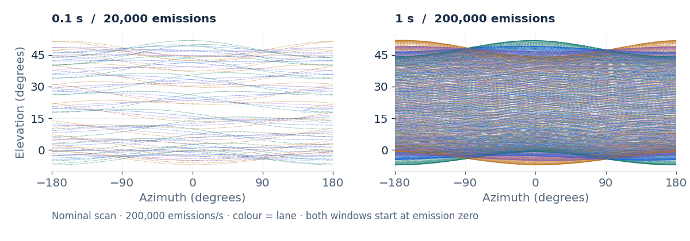
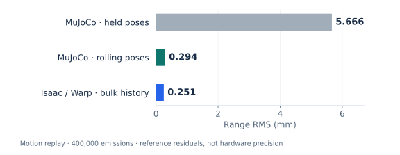

<!-- SPDX-License-Identifier: MIT OR Apache-2.0 -->
<!-- Copyright (c) 2026 hxyulin <hxyulin@proton.me> -->
# mid360-sim

A rolling MID-360 LiDAR approximation for robotics simulators.

[Documentation](https://hxyulin.github.io/mid360-sim/) ·
[Installation](docs/guide/getting-started.md) ·
[Validation](docs/guide/validation.md) · [Changelog](CHANGELOG.md)

Worked examples: [public scans into simulated LiDAR](docs/guide/scanned-geometry.md) ·
[synchronized LiDAR/IMU and a live RM host](docs/guide/synchronized-sensors.md) ·
[TF, PointCloud2 and a LIO regression](docs/guide/navigation-demo.md).

Generate a compact, nonrepeating scan, query your simulator's scene, and keep
each return's acquisition time. The default model emits 200,000 rays/s across
four interleaved lanes, with a representative 18.2-hour cycle. It is an empirical
approximation, not a calibrated Livox hardware emulator.



[See the figures and measured results](docs/guide/results.md), including motion
fidelity, GPU runtime and native ROS delivery with explicit test conditions.

| Use it with | Integration | Output |
|---|---|---|
| Your Rust simulator | [Dependency-free core](docs/install/rust.md) | Local points, ranges and timestamps |
| ROS 2 Jazzy | [rclrs + Pixi/RoboStack](docs/install/ros2.md) | Livox / PointCloud2, caller IMU, physical TF and /clock |
| Isaac Sim | [Warp GPU extension](docs/install/isaac-sim.md) | Optical mesh queries and Livox fields |
| MuJoCo | [Python adapter](docs/install/mujoco.md) | Native CPU rays and Livox fields |
| Gazebo Harmonic | [C++ system plugin](docs/install/gazebo.md) | Native PointCloudPacked |

## Quickstart

Use Python 3.10+ in a virtual environment. From this checkout:

```sh
python -m pip install './integrations/python[mujoco]'
python -m unittest discover -s integrations/python/tests -v
```

Add a `lidar` site to your MJCF model, then query your existing scene:

```python
import mujoco
from mid360_sim.mujoco import MujocoSensor

model = mujoco.MjModel.from_xml_path("robot.xml")
data = mujoco.MjData(model)
mujoco.mj_forward(model, data)
sensor = MujocoSensor(model, data, "lidar")
frame = sensor.scan(first_index=0, count=200)  # 1 ms at full rate
print(frame.livox_fields())
```

The caller advances physics and the emission index. For ROS, start with
`pixi run smoke`; for other backends, follow the installation links above.
[Release artifacts](docs/distribution.md) include a Python wheel, an Isaac
extension ZIP and source bundles. No simulator runtime or recorded dataset is bundled.

## Motion and realism

Raw points stay in the sensor frame at their own emission time; consumers own
deskewing. Isaac interpolates sensor poses per ray and supports per-step scene
capture, static tracing and explicit moving-geometry partitions. MuJoCo offers
held-pose queries or optional rolling sensor poses; its geometry stays current
per call. Gazebo samples the physics scene per step. Acquisition and publication
intervals are independent; batching output does not require freezing acquisition.

The [validation guide](docs/guide/validation.md) distinguishes hardware-derived
scan fits, controlled tests and motion-capture comparisons. The
[runtime/accuracy report](docs/performance-tradeoffs.md) compares actual native
backends, including the official plugin, with explicit measurement scopes.
See [capabilities and status](docs/guide/status.md) for supported interfaces,
caller responsibilities and remaining validation. Guides track the current
source; check a release archive's source revision before relying on newer APIs.

## Measured results

Selected bounded experiments; each result has its own workload and reference.

| Question | Recorded result | Conditions and evidence |
|---|---|---|
| Does rolling acquisition preserve motion? | **5.666 → 0.294 mm RMS** for MuJoCo | Two-second MoCap stress replay in an exact room; reference agreement, not hardware precision. [Motion results](docs/backend-ground-truth.md) |
| Can GPU tracing run faster than real time? | **18.07× real time** in the original Warp loop | Static room, RTX 5090, headless bulk history, USD writeback off; includes native physics. [Runtime scope](docs/performance-tradeoffs.md) |
| Do cloud and IMU messages reach a real subscriber? | **305/305 clouds + 6,100/6,100 IMUs** per format | One 30-second Cyclone/rclpy reference each on macOS arm64; loaded cases also show losses. [Transport results](docs/transport-evaluation.md) |



[Visual results and figure sources](docs/guide/results.md) ·
[Complete validation and limits](docs/guide/validation.md)

## Development

See [CONTRIBUTING.md](CONTRIBUTING.md) for checks, source boundaries and release
preparation. `cargo test --locked` runs the Rust core without ROS or a simulator.

## License

MIT OR Apache-2.0. [NOTICE.md](NOTICE.md) records Livox provenance, derived model
parameters and optional runtime dependencies. The ETH3D example's data-derived
documentation illustrations retain their separate CC BY-NC-SA 4.0 terms.
